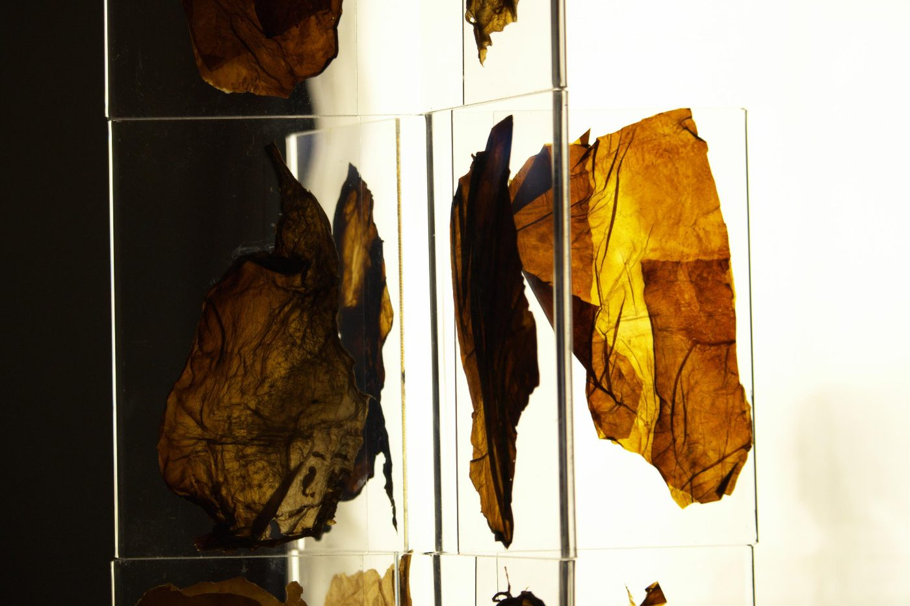
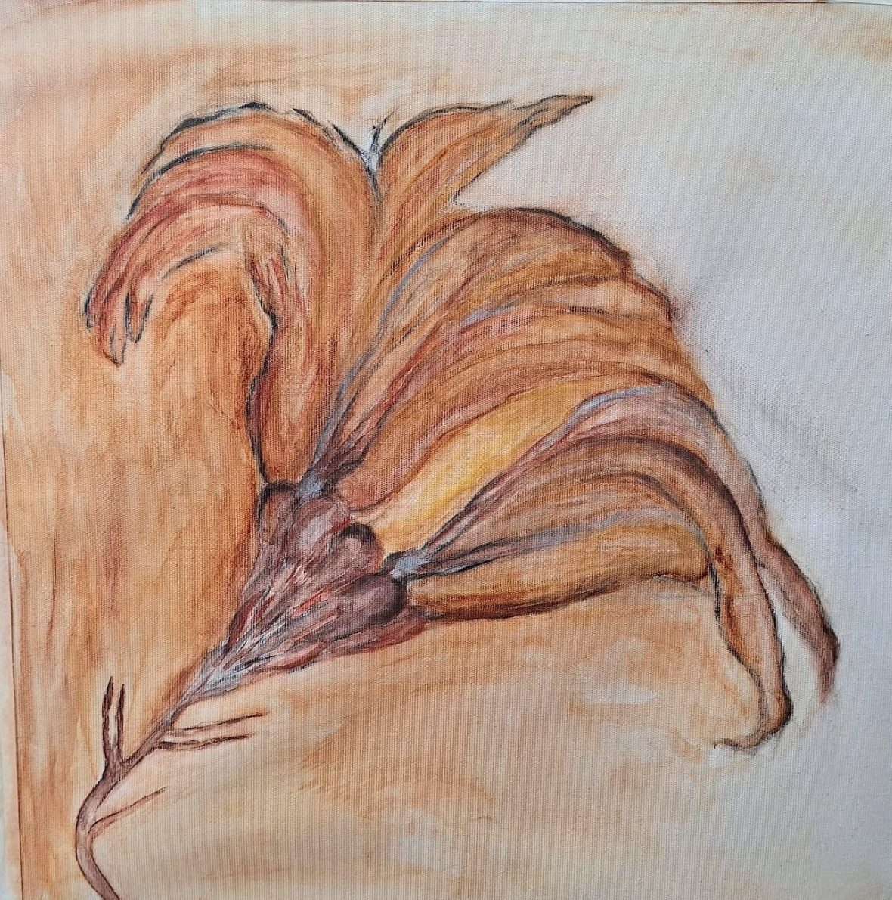
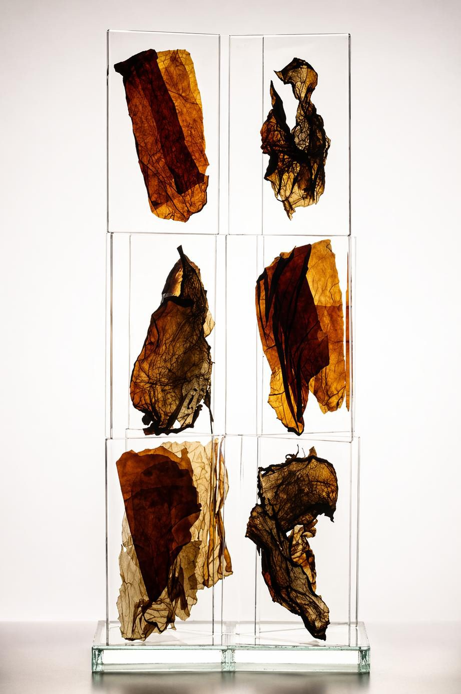
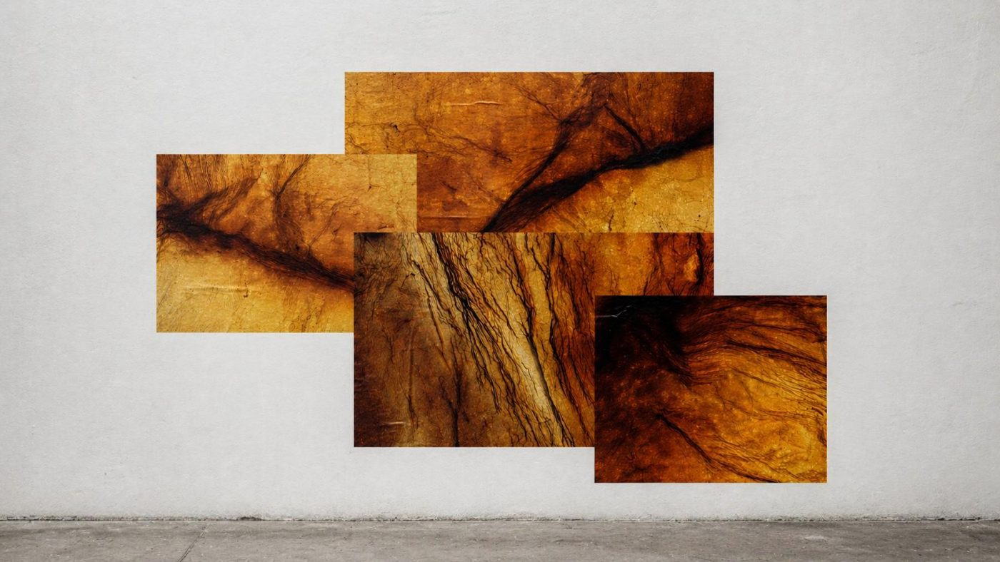
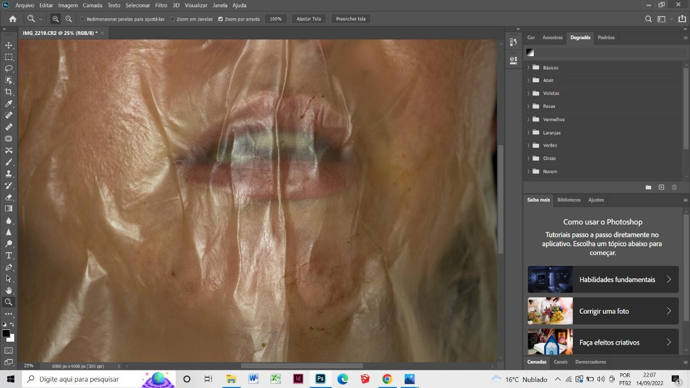

<section class="capa">
  
  

    <h1>Giovanna Pizzini</h1>
    
Artista visual

  

</section>

<section class="section section--estreita">

Minha pesquisa situa-se na interseção entre arte, ciência e tecnologia,
investigando os processos dialéticos do corpo em relação a materiais orgânicos como
biocelulose, argila e geotinta.

<a class="button" href="/o-corpo-como-escavacao/">O Corpo como Escavação</a>

</section>

<section class="section">

Em destaque

## O Corpo como Escavação

  
  

    
A pintura como campo de sedimentação e escavação. Geotintas, pigmentos
    minerais, carvão e giz pastel cerâmico aproximam a prática pictórica de
    processos geológicos e ecológicos.

    
<a href="/o-corpo-como-escavacao/">Ver a exposição</a>

  

</section>

<section class="section">

Séries

## Trabalhos

  <a class="serie" href="/trabalhos/#estruturas-do-invisivel">
    
    <h3>Estruturas do Invisível</h3>
  </a>
  <a class="serie" href="/trabalhos/#corpos-difusos">
    
    <h3>Corpos difusos</h3>
  </a>
  <a class="serie" href="/trabalhos/#entre-peles">
    
    <h3>ENTRE PELES</h3>
  </a>

<a href="/trabalhos/">Ver todas as séries</a>

</section>
