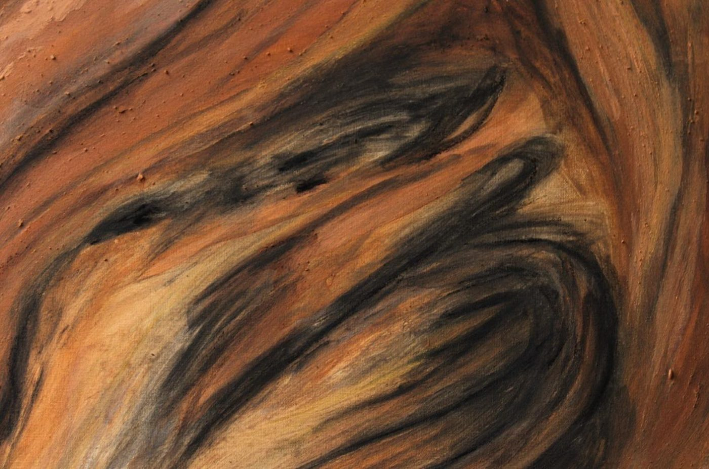
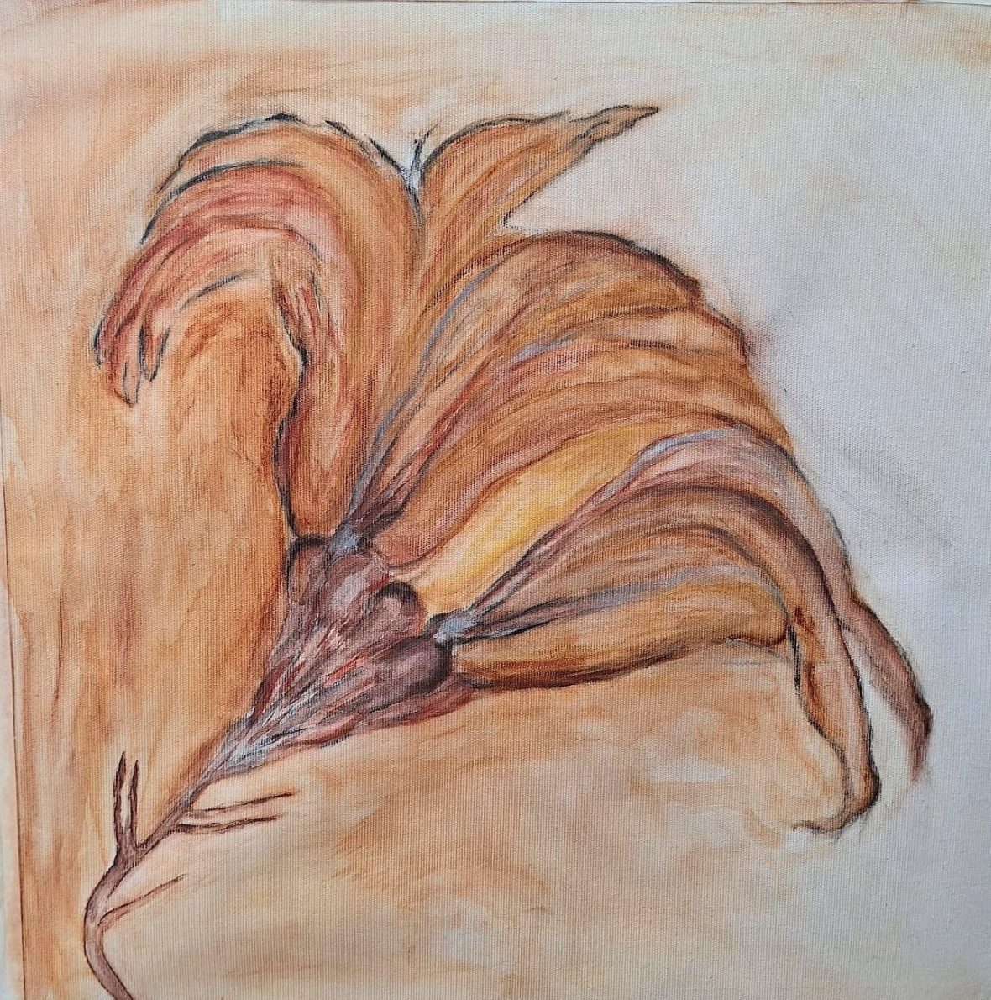
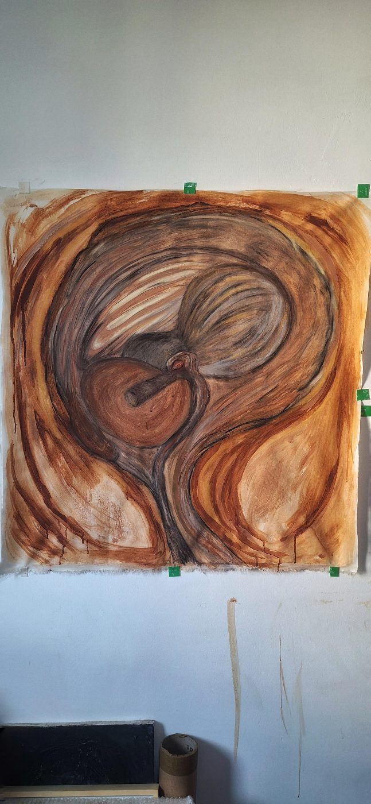
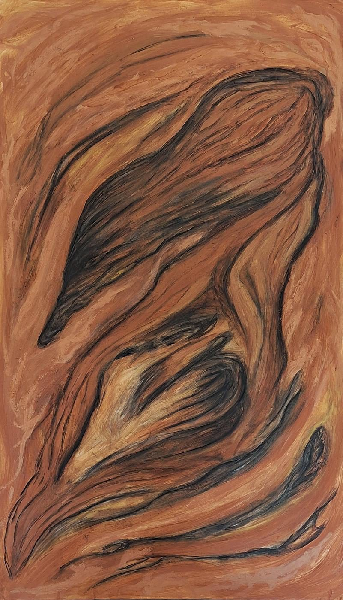
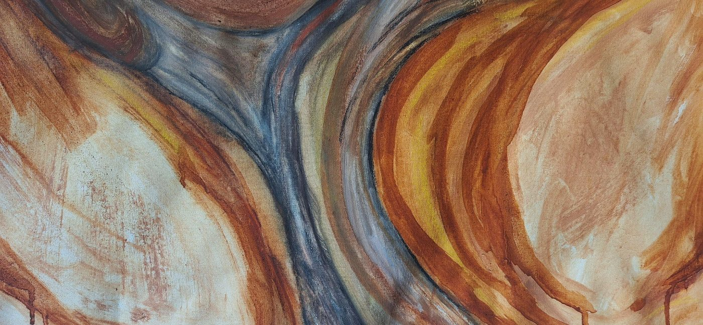

<section class="abertura">
  
</section>

<section class="section section--estreita">

# O Corpo como Escavação

Instituto de Arte e Ciência, São Lourenço da Serra — SP, 2025 
Curadoria: Cláudia Madella-Auricchio

Ao escavar, perpasso por mim e pelo outro,
animal ou vegetal.
Sigo seus rastros, tateio sua memória matérica,
encapsulada pela passagem do tempo geológico.

Vestígios de permanência:
para onde vai a memória do invisível que criamos?
Este corpo, de subjetividades, tão humano, tão singular.
O que deixa ao planeta, além do próprio pó
e das memórias que se entrelaçam às histórias de outros corpos?

Presente no passado distante.
Como a existência do corpo em movimento,
vivo, pensante.
Subverte o tempo?

Como o sentir, o perceber-se ao encontro,
perpassa as camadas endógenas em si.
Perceber-se no mundo, parte do mundo,
inscrição de memórias, carnes de outras carnes.
Como é estar no mundo assim?

Como perdurar, sem destroçar as finas camadas
que nos separam em linguagem e não linguagem?
Tateio o tempo para permear o presente.
Nele deixo rastros.
Sou, enfim, parte da memória de um corpo ancestral.

Giovanna Pizzini

</section>

<section class="section section--estreita">

## A pintura como escavação

Nesta série, a artista investiga a pintura como campo de sedimentação e escavação.

Utilizando geotintas, pigmentos minerais, carvão e giz pastel cerâmico, aproxima a
prática pictórica de processos geológicos e ecológicos. A matéria não é apenas meio,
mas território ativo.

A construção da imagem ocorre por camadas sucessivas. A artista deposita, borra,
cobre e retira. Do apagamento surgem novas formas. Da sobreposição, emergem
vestígios. O gesto é corporal e, muitas vezes, performático, ativando a superfície
como espaço de fricção entre corpo e terra.

As imagens evocam fósseis, organismos e paisagens internas, não como representação
direta, mas como resultado de um processo que simula erosão, compressão e
transformação.

A pintura torna-se vestígio de um tempo expandido, onde o humano e o geológico se
atravessam.

As obras reunidas aqui integram a série <em>Conjunções do Vazio: O corpo
como escavação</em>, em desenvolvimento desde 2022. A pesquisa passou também pela
residência de 2024 no Instituto de Arte e Ciência, em Itu, com curadoria e
acompanhamento de Cláudia Madella-Auricchio.

</section>

<section class="section">

Obras

<figure class="obra obra--larga">
  
  <figcaption>
    <strong>Scyphocrinites</strong>, 2025. 
    Pigmentos minerais, carvão e geotinta sobre tela. 30 × 30 × 1 cm.
  </figcaption>
</figure>

  <figure class="obra">
    
    <figcaption>
      <strong>Sem Título I</strong>, 2022–2025. Políptico. 
      Barro, carvão, giz pastel cerâmico e cera vegetal sobre tela. 84 × 30 × 2 cm.
    </figcaption>
  </figure>
  <figure class="obra">
    
    <figcaption>
      <strong>Sem Título I</strong>, 2022–2025. Políptico. 
      Barro, carvão, giz pastel cerâmico e cera vegetal sobre tela. 84 × 30 × 2 cm.
    </figcaption>
  </figure>

<figure class="obra obra--larga">
  
  <figcaption>Detalhe de <strong>Sem Título I</strong>.</figcaption>
</figure>

</section>
