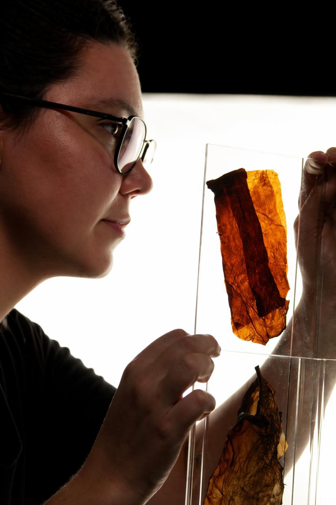

<section class="section">

  
  

# Giovanna Pizzini

n. 1997, São Paulo, Brasil 
Vive e trabalha em Belo Horizonte, MG, Brasil

Giovanna Pizzini é artista visual e produtora cultural, graduada em Cinema e
Audiovisual pelo CEUNSP (2020). Sua prática se desenvolve na interseção entre arte,
ciência e tecnologia, a partir do uso de materiais orgânicos e processos
experimentais.

Sua pesquisa investiga a construção de dispositivos sensíveis e sistemas relacionais
que articulam corpo, materialidade e ambiente.

Transitando entre performance, instalação, fotografia e videoperformance, a artista
opera o corpo como campo de mediação, tensionando as fronteiras entre interioridade
e exterioridade, natureza e técnica.

Através de processos de transformação, decomposição e reorganização da matéria,
Pizzini instaura situações em que diferentes regimes de existência se atravessam,
propondo deslocamentos na percepção do humano em relação ao seu entorno.

  

</section>

<section class="section section--estreita">

<blockquote class="statement">

Minha pesquisa situa-se na interseção entre arte, ciência e tecnologia, investigando
os processos dialéticos do corpo em relação a materiais orgânicos como biocelulose,
argila e geotinta. Interessa-me compreender a matéria como agente ativo e pensar a
obra como sistema relacional atravessado pela percepção.

Desenvolvo dispositivos híbridos que tensionam as fronteiras entre interior e
exterior, natureza e técnica, visível e invisível. Utilizo o corpo como campo de
mediação, instaurando fricções entre gesto, matéria e ambiente.

Minha investigação emerge da observação de camadas biológicas, psíquicas e
geológicas, aproximando processos orgânicos e tecnológicos. Ao trabalhar com
tecnologias vivas e pigmentos naturais, proponho sistemas sensíveis instáveis, onde
identidade, território e ecossistema se entrelaçam.

A obra não se configura como representação, mas como ativação, espaço onde matéria e
percepção se co-constroem.

</blockquote>

</section>

<section class="section section--estreita" id="curriculo">

## Currículo

### Exposições

<ul class="curriculo">
  <li>2025 <strong>ECOPOIESIS</strong>. Museu Nacional da República, Brasília — DF. Curadoria: Dra. Suzete Venturelli.</li>
  <li>2025 <strong>PANORAMA 6</strong> (coletiva). Centro Cultural da UFMG — MG. Prof. Dr. Pablo Gobira, CIACT-SAD 09, Labfront UEMG.</li>
  <li>2025 <strong>O Corpo como Escavação</strong>. Instituto de Arte e Ciência, São Lourenço da Serra — SP. Curadoria: Cláudia Madella-Auricchio.</li>
  <li>2024 <strong>Gramáticas da Natureza: Encontros Multiespécies</strong>. São Paulo — SP. Curadoria: Carolina Cornonato e Victor Barão.</li>
  <li>2024 <strong>Corpo Paisagem Paisagem Corpo</strong>. Casa Contemporânea — SP. Curadoria: Evandro Angerami e Andrés Hernández.</li>
  <li>2024 <strong>PANORAMA 5</strong> (coletiva). Centro Cultural da UFMG — MG. Curadoria: Prof. Dr. Pablo Gobira, CIACT-SAD 09, Labfront UEMG.</li>
  <li>2023 <strong>Afetos insurgentes: Corpos em conexão</strong> (coletiva). Centro Cultural Correios — RJ. Curadoria: Amanda Leite e Cota Azevedo.</li>
  <li>2023 <strong>Paralela EIXO</strong> (coletiva). Galeria EIXO Reserva, Niterói — RJ. Curadoria: Vilmar Madruga e Sara Figueiredo.</li>
  <li>2023 <strong>ENTRE PELES</strong>. Semana da Fotografia, Caxias do Sul — RS. Curadoria: Liliane Giordano e Mona Carvalho.</li>
  <li>2022 <strong>ARtérias na ceRÂmica</strong> (coletiva). Galeria Andréa Rehder Arte Contemporânea — SP. Curadoria: Andrés Hernández.</li>
  <li>2022 <strong>Multiplicidade das Coisas</strong> (coletiva). Subsolo Laboratório de Arte, Campinas — SP. Curadoria: Andrés Hernández.</li>
  <li>2022 <strong>EIXO ARTE</strong> (coletiva). Rio de Janeiro — RJ. Curadoria: Sara Figueiredo.</li>
  <li>2021 <strong>SYMPHONY</strong>. The Holy Art Gallery, Londres, Reino Unido.</li>
</ul>

### Residências

<ul class="curriculo">
  <li>2026 <strong>RAVC-6 Bienal Black</strong>, online. Curadoria e acompanhamento: Luciana Conceição (SP), Priscila Rezende (BH), Patricia Brito (POA) e Zaika dos Santos (BH).</li>
  <li>2024 <strong>O corpo como escavação</strong>. Instituto de Arte e Ciência, Itu — SP. Curadoria e acompanhamento: Dra. Cláudia Madella-Auricchio.</li>
  <li>2023 <strong>Pau Ferro</strong>, Itu — SP. Curadoria: Sylvia Werneck. Acompanhamento: Raquel Fayad.</li>
  <li>2021 <strong>Kaaysa Residency Lab 2</strong>, São Sebastião — SP. Curadoria: Rodrigo Villela. Curador convidado: Theo Monteiro. Acompanhamento: Cristina Suzuki.</li>
</ul>

### Formação

<ul class="curriculo">
  <li>2016—2019 Bacharel em Cinema e Audiovisual, CEUNSP — SP.</li>
</ul>

### Publicações

<ul class="curriculo">
  <li>2026 Em pré-produção: livro <em>Artérias da Cerâmica: obras comentadas</em>, do curador Andrés Hernández.</li>
  <li>2023 Revista Creator, edição de novembro, n. 10.</li>
  <li>2022 Revista Tonel USP, n. 5.</li>
</ul>

### Grupos de estudo

<ul class="curriculo">
  <li>2024 Ouvinte e artista no congresso CIACAT — SAD 9, organizado pelo LABFRONT, UEMG — MG.</li>
  <li>2024 Gramáticas da Natureza: Encontros Multiespécies. Mediação: Carolina Cornonato e Victor Barão, São Paulo — SP.</li>
  <li>2024 O Pós-Humano. Mediação: Prof. Dr. Pablo Gobira, UEMG, Belo Horizonte — MG.</li>
  <li>2023 Arte, Feminismo e Tecnologia. Mediação: Profa. Dra. Venise Melo, UFMS, Campo Grande — MS.</li>
</ul>

### Cursos complementares

<ul class="curriculo">
  <li>2023—2024 Poéticas e processos artísticos. Andrés Hernández e Evandro Angerami.</li>
  <li>2021 Interface vídeo e performance. Oficinas Culturais Oswaldo de Andrade — SP. Tales Frey.</li>
  <li>2021 Fotoperformance: sua breve história da arte e uma prática. Projeto Festas. Paula Borghi.</li>
  <li>2021 Psicanálise e Arte: como se inscreve um corpo. Adelina Instituto — SP. Bianca Coutinho Dias.</li>
  <li>2020 Mentoria artística — SP. Katia Salvany.</li>
  <li>2020—2021 Aprendiz de artista. Ateliê Por Enquanto, com Bruno Passos.</li>
  <li>2020 O desenho na arte contemporânea: das vanguardas à contemporaneidade. PUC-RJ. Valerio Ricci Montani.</li>
</ul>

### Trabalho em ateliê

<ul class="curriculo">
  <li>2023 Assistente do artista Gilberto Gomes, Sorocaba — SP.</li>
  <li>2021 Assistente de ateliê do artista Lucas Lander, para a individual <em>Imanência</em> — SP.</li>
  <li>2021 Assistente de ateliê da artista Carla Borba, Itu — SP.</li>
  <li>2020—2021 Produtora de ateliê do artista Bruno Passos, Itu — SP.</li>
  <li>2020 Assistente de produção e montagem do projeto <em>Rejeito</em>, do artista Marcelo Moscheta, contemplado pelo edital FAMA Museu e Campo da 15ª SP-Arte, Itu — SP.</li>
</ul>

</section>
