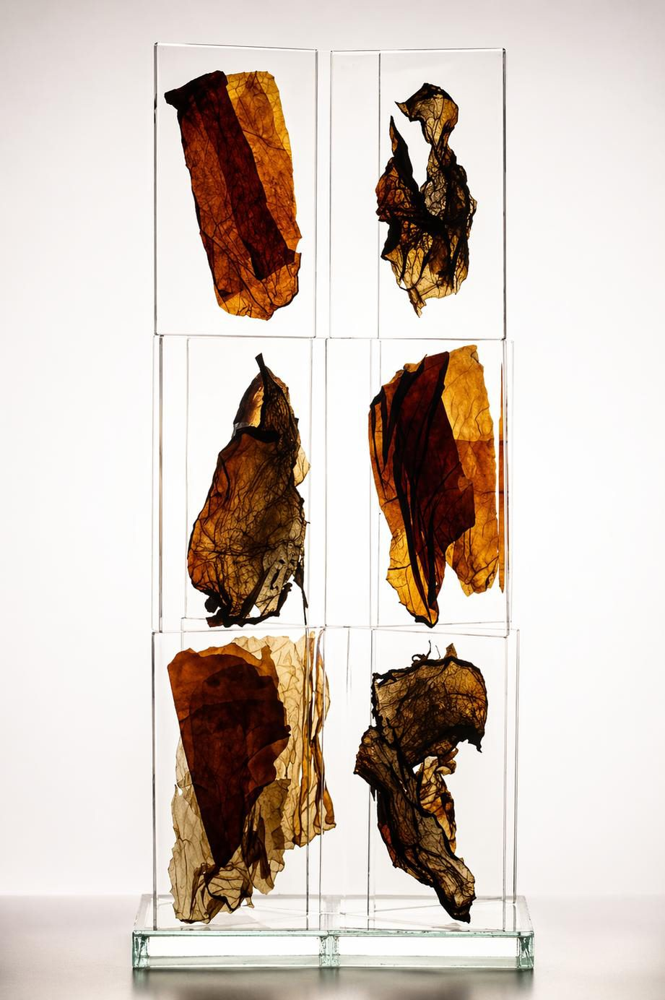
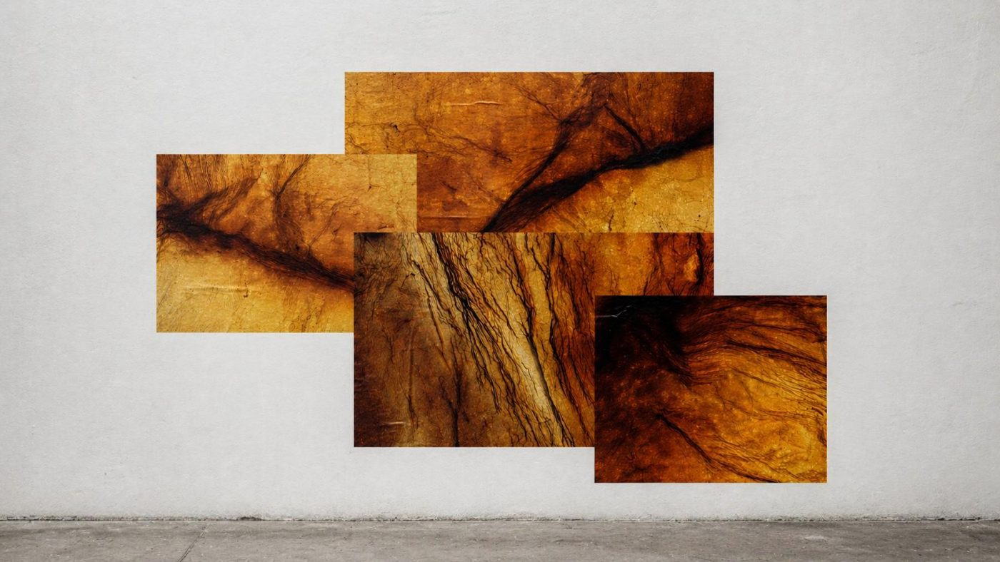
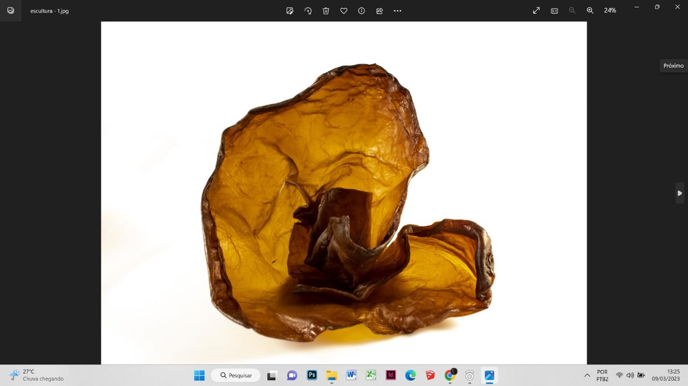
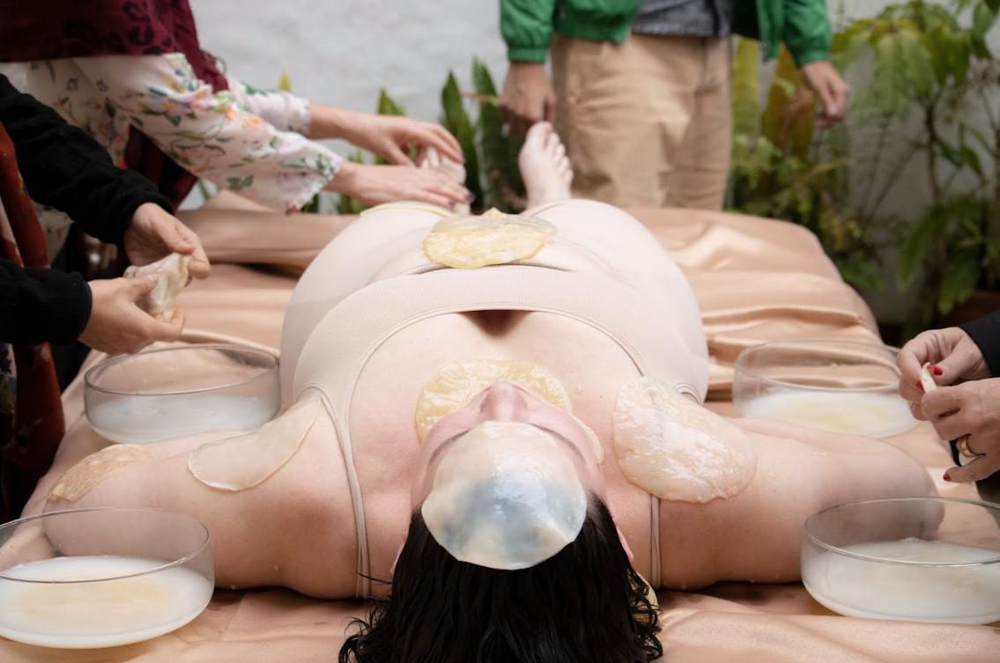
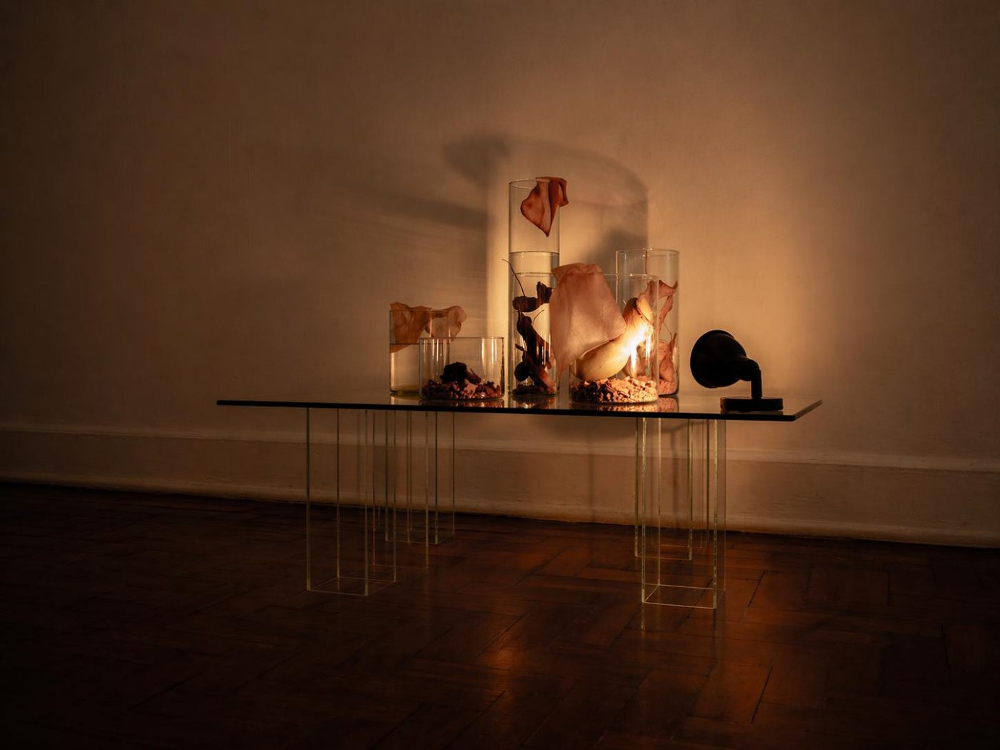
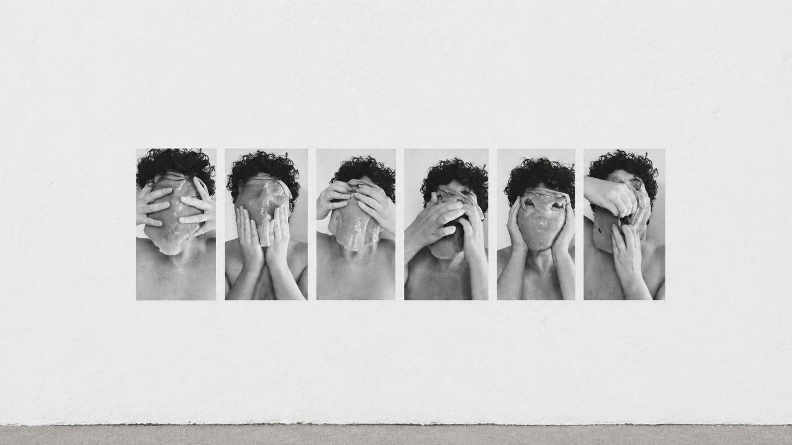
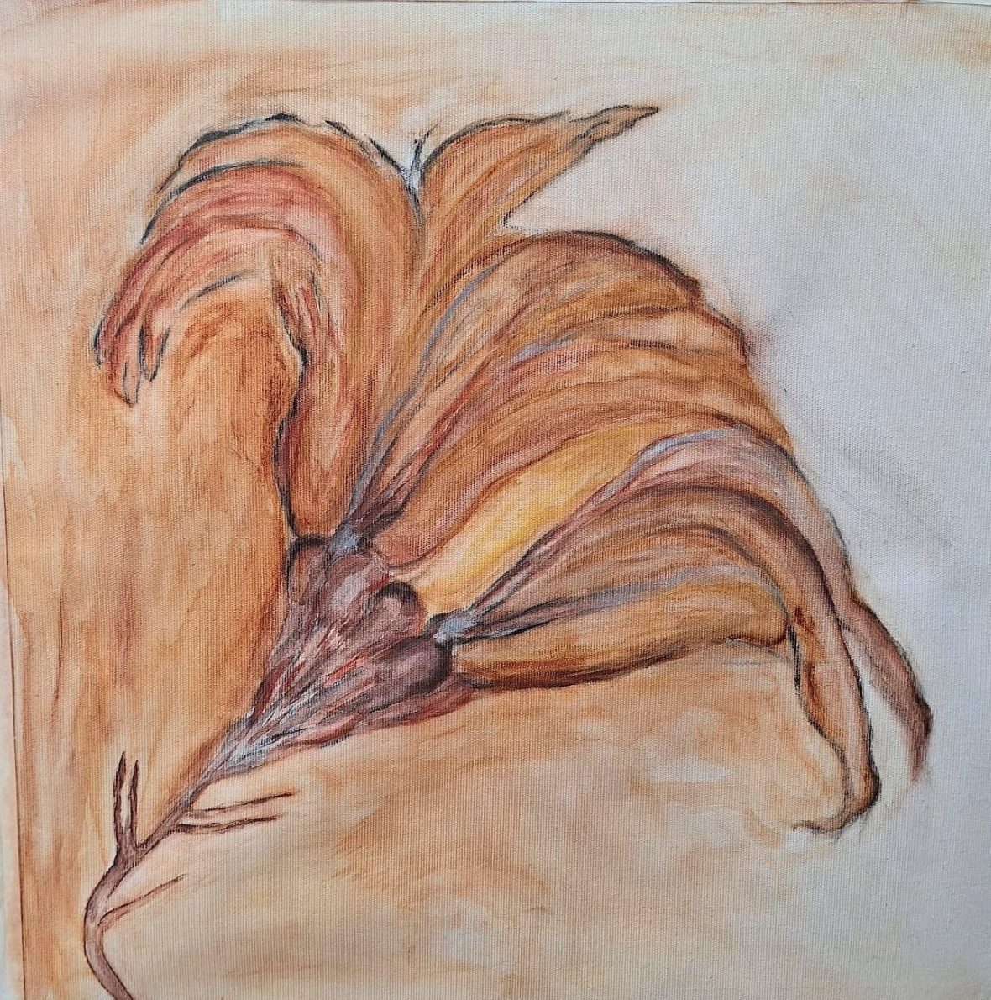
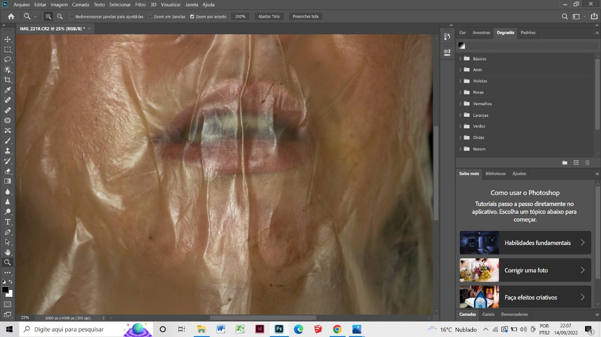
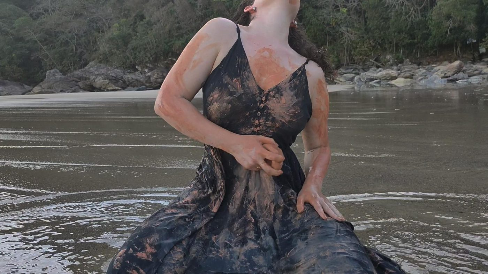
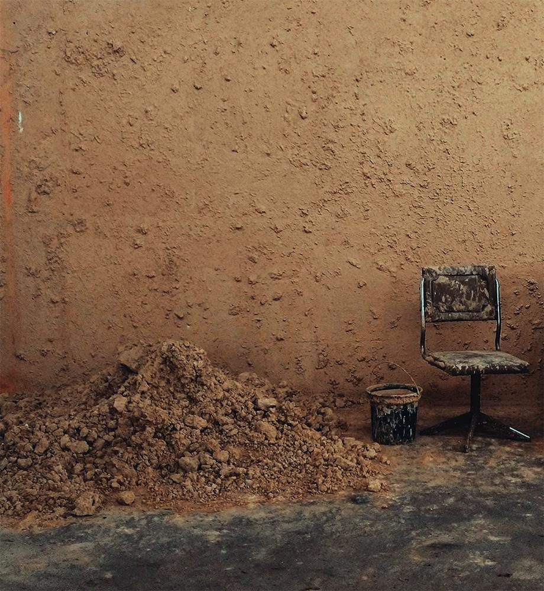

<section class="section section--estreita">

# Trabalhos

Transitando entre performance, instalação, fotografia e
videoperformance, a artista opera o corpo como campo de mediação, tensionando as
fronteiras entre interioridade e exterioridade, natureza e técnica.

</section>

<section class="section">

<article class="serie-longa" id="estruturas-do-invisivel">
  
  

    <h2>Estruturas do Invisível</h2>
    
2024 — atualmente

    
Uma série que investiga as camadas não visíveis que moldam o corpo e sua
    relação com o ambiente. A pesquisa utiliza a biocelulose como extensão da pele,
    um material orgânico que cresce e se transforma em diálogo com o espaço,
    operando como membrana sensível entre interior e exterior.

  

</article>

<article class="serie-longa" id="corpos-difusos">
  
  

    <h2>Corpos difusos</h2>
    
2024 — atualmente

    
Investiga processos de transformação a partir da relação entre organismos
    vegetais, colônias microbianas e imagem. As próprias fotografias são imersas no
    chá de kombucha e posteriormente refotografadas, atravessando processos
    materiais que tensionam permanência e deterioração.

  

</article>

<article class="serie-longa" id="projecoes-sobre-a-pele">
  
  

    <h2>Projeções sobre a pele</h2>
    
2023 — atualmente

    
A artista investiga a materialidade da biocelulose em diferentes suportes e
    estágios de desenvolvimento, estabelecendo relações com os processos de
    transformação do corpo. Colônia simbiótica de bactérias e leveduras, a
    biocelulose opera como metáfora viva para dinâmicas de adaptação, crescimento e
    instabilidade.

  

</article>

<article class="serie-longa" id="projecoes-sobre-a-mesa">
  
  

    <h2>Projeções sobre a Mesa</h2>
    
2023 — atualmente

    
Performance em que a artista convida o público a intervir diretamente sobre
    seu corpo. Disposta sobre uma mesa, ela permanece imóvel enquanto quarenta
    bioceluloses, cultivadas pela própria artista, são manipuladas e depositadas
    pelos participantes.

  

</article>

<article class="serie-longa" id="aquilo-que-esta-entre">
  
  

    <h2>Aquilo que está entre</h2>
    
2023 — atualmente

    
Nesta instalação, a artista reúne materiais que vêm sendo foco de sua
    investigação: a biocelulose seca, a argila e a planta carnívora nepenthes. O
    vidro e a água criam reflexos, pontos de foco e projeções que se articulam ao
    conjunto, estimulando uma experiência imersiva.

  

</article>

<article class="serie-longa" id="entre">
  
  

    <h2>ENTRE</h2>
    
2023

    
Série de fotoperformances realizadas para a câmera, nas quais a artista
    estabelece uma relação direta com a materialidade da biocelulose, cultivada em
    seu ateliê ao longo de dezoito dias. Os gestos se repetem entre pressionar,
    cobrir e tentar remover, instaurando um embate entre resistência e adaptação.

  

</article>

<article class="serie-longa" id="conjuncoes-do-vazio">
  
  

    <h2>Conjunções do Vazio: O corpo como escavação</h2>
    
2022 — atualmente

    
A pintura como campo de sedimentação e escavação. Geotintas, pigmentos
    minerais, carvão e giz pastel cerâmico aproximam a prática pictórica de
    processos geológicos e ecológicos. A matéria não é apenas meio, mas território
    ativo.

    
<a href="/o-corpo-como-escavacao/">Ver a exposição O Corpo como Escavação</a>

  

</article>

<article class="serie-longa" id="entre-peles">
  
  

    <h2>ENTRE PELES</h2>
    
2022 — 2023

    
Série de fotografias realizadas com o scoby, que se apresenta como uma
    película sobre a imagem, tensionando os limites entre corpo, matéria e
    superfície. O material foi sobreposto ao corpo da artista, que realizou os
    registros de forma autônoma, utilizando o visor da câmera e o disparo por
    temporizador.

  

</article>

<article class="serie-longa" id="travessia">
  
  

    <h2>Travessia: Tomo a ti, minha própria carne</h2>
    
2022

    
Por meio de uma metáfora, a artista cria um ritual psicológico e simbólico de
    atravessamento, com argila vermelha, espelho redondo, água, areia e vestido
    preto. Envolve a argila no próprio corpo, enterra em seguida o objeto e segue,
    ao final da travessia, para o mar.

  

</article>

<article class="serie-longa" id="nao-lugar">
  
  

    <h2>Não Lugar</h2>
    
2021

    
Instalação site-specific a partir de uma investigação sobre espaços de
    transição, entendidos como zonas do entre, do deslocamento e da suspensão. Com
    argila e água, a artista constrói camadas sucessivas de barro sobre a parede,
    por meio de gestos repetidos que formam uma matéria espessa e orgânica.

  

</article>

</section>
